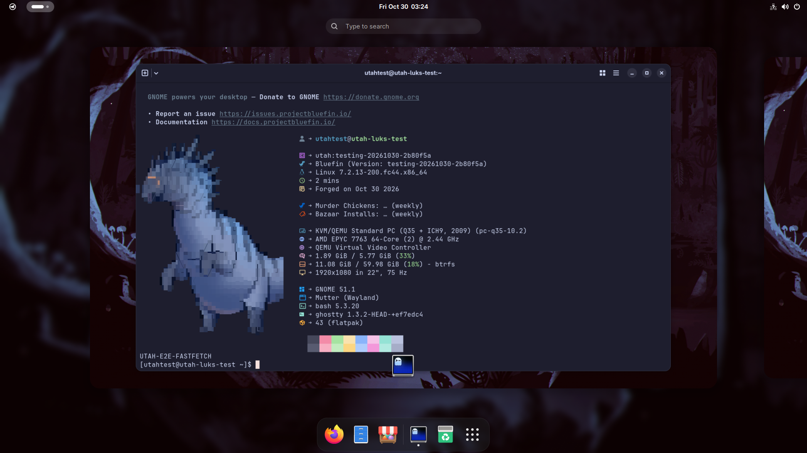

# Utahraptor

<!-- BEGIN E2E VERIFICATION -->
[](docs/verification/README.md)

*LUKS ISO test passed for commit `d0f7361a65a1`. [CI run](https://github.com/projectbluefin/utah/actions/runs/40133928234); [screenshots and provenance](docs/verification/README.md).*
<!-- END E2E VERIFICATION -->

†Utahraptor ostrommaysi

Bluefin built on Fedora Hummingbird. The more ... civilized murder machine.

> Your day keeps getting worse. Why are there more.

**Experimental pre-alpha** — the image builds, boots, and installs end to
end in local QEMU validation: the live ISO's bootc-installer creates a
LUKS2-encrypted disk from the ISO's embedded container store with no
network, and the installed system boots on its own to GDM and a GNOME
session (verified record: [docs/verification](docs/verification/README.md)).
Testing container images and live ISOs are available for hardware testing,
but nothing here is ready to run on a machine you care about yet. [Filing
issues](https://github.com/projectbluefin/utah/issues) is the whole point.

## What it is

[Bluefin](https://projectbluefin.io) built on
[Fedora Hummingbird](https://fedoramagazine.org/fedora-hummingbird-linux-taking-the-hummingbird-model-to-the-full-os/) —
a minimal, hardened bootable container base that ships without a desktop. Utah
adds the Bluefin experience and a GNOME 51 desktop compiled from upstream
source.


Utah is built across two repositories:

| Repository | What it does |
| --- | --- |
| [`projectbluefin/utah`](https://github.com/projectbluefin/utah) | Assembles the bootable OS image and live ISO. |
| [`projectbluefin/utah-packages`](https://github.com/projectbluefin/utah-packages) | Compiles GNOME 51 and desktop packages from source into an OCI repository. |

## Download and image streams

- **Testing ISO (AMD / Intel):** [`utah-live-latest.iso`](https://projectbluefin.dev/utah-live-latest.iso) ([SHA-256 checksum](https://projectbluefin.dev/utah-live-latest.iso-CHECKSUM))
- **Live versions & downloads:** [docs.projectbluefin.io/utah](https://docs.projectbluefin.io/utah)

The testing ISO is hosted on projectbluefin.dev, not published by this
repository's workflows (CI here only uploads `utah-live.iso` as a short-lived
workflow artifact). Verify the download against its checksum before use.

Like Bluefin, Utah builds four hardware flavors (`utah`, `utah-nvidia`,
`utah-gaming`, `utah-nvidia-gaming`) from `config/flavors.json`:

| Tag | Stream | Status |
| ---: | ---: | :--- |
| `:testing` | Testing | Published at `ghcr.io/projectbluefin/utah:testing` after end-to-end ISO validation passes. |
| `:stable` | Stable | Rolling tag, moved from `:testing` on each promotion to `main` after the release gate passes on the exact candidate digests. Pre-alpha like everything here. |

## Package parity with Bluefin

`packages/bluefin.toml` is a byte-for-byte copy of Bluefin's `base.toml`, checked in CI on every run so the package list never drifts silently.

| | count |
| --- | --- |
| Bluefin contract installed | **61** |
| Utah additions (GNOME 51, base-image parity, device firmware, desktop services) | 251 |
| Genuinely unavailable | **7** |

## Known gaps

Why this is still pre-alpha:

- **Disable Secure Boot.** The live ISO (`systemd-boot-unsigned`), custom OGC kernel, NVIDIA driver, and `v4l2loopback` module are not signed yet. Boot via UEFI with Secure Boot off, and flash the ISO directly with Fedora Media Writer or `dd` (Ventoy and legacy BIOS are unsupported). The live session runs SELinux permissive; installed systems run Enforcing.
- **Switching from another `bootc` image.** Ostree's 3-way `/etc` merge can carry over `bootc-fetch-apply-updates.timer` from another image. Utah masks `bootc-fetch-apply-updates` so background updates go through `uupd` instead of silently undoing a `bootc rollback`. After switching, check `systemctl is-enabled bootc-fetch-apply-updates.timer`.
- **Bootloader updates.** Systems on `systemd-boot` update their EFI partition via `bootctl` (`systemd-boot-update.service`), so `bootupctl status` intentionally shows no components. Check `bootctl status` instead.
- **Hardware, codecs, and drivers need real-world testing.** Intel/Linux Wi-Fi firmware and Intel media drivers are included, and the OGC kernel (`sched_ext`, `binderfs`) and open NVIDIA module compile, but hardware video decoding, Wi-Fi, and gaming flavors still need testing on physical machines (#383).
- **CUDA is excluded** to save 7.68 GB in the base image. Use the included NVIDIA Container Toolkit to run CUDA inside containers.

See the [open issues](https://github.com/projectbluefin/utah/issues) to track progress or report bugs.

## Persistent SELinux changes

SELinux stays enforcing on Utah, and lasting policy changes are made with the
same commands as on Bluefin: `sudo setsebool -P` for a boolean,
`sudo semanage fcontext` for a file-labelling rule, `sudo semanage port` for a
port label, and `sudo semodule -i` for a local module built with `audit2allow`.
Each of those survives a reboot.

Hummingbird's base image keeps the SELinux policy store under `/usr`, which is
read-only on a running system, so all of those commands used to fail — the
first of them silently. Utah moves the store to `/etc/selinux`, where Fedora
atomic and Bluefin keep it (links #551).

What happens on an update: the system rebuilds the policy in the new
deployment from the new image's policy plus your local changes, so both take
effect after the reboot. Nothing you changed is lost, and new policy shipped
in the image still reaches your machine.

One case needs attention: a local module the new image's policy can no longer
satisfy (for example, one that refers to a type the new policy removed) stops
that update from being applied. The machine simply keeps running the image it
had; nothing breaks. To recognise it, `bootc status` still shows the old image
after a reboot, and the log of the step that finalises updates names the
failed policy rebuild:

```bash
journalctl -b -1 -u ostree-finalize-staged.service
```

To recover, remove the module (`sudo semodule -r <name>`) and update again.
If you would rather discard every local SELinux change, restore the image's
own copy of the store and reboot:

```bash
sudo mv /etc/selinux /etc/selinux.local && sudo cp -a /usr/etc/selinux /etc/selinux
```

Changes carried in from another image (for example, a machine switched to
Utah from Bluefin) are kept, but are not promised to take effect on Utah.

## Contributing

See [docs/building.md](docs/building.md) to build locally, [docs/skills/](docs/skills/) for architecture docs, and [AGENTS.md](AGENTS.md) for agent rules.
