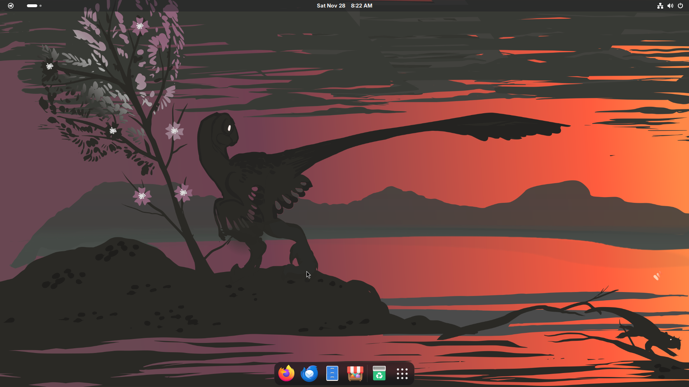

# Utahraptor

<!-- BEGIN E2E VERIFICATION -->
[](https://github.com/projectbluefin/utah/blob/0cfb37c9129709d70eb63117ba8a7b50c368c509/README.md)

*gnome-setup install test passed for commit `97af8f63c035`. [CI run](https://github.com/projectbluefin/utah/actions/runs/46001817653) also runs independent desktop tests that do not gate this record; every flavor installed, booted, switched and rolled back; [screenshots and provenance](https://github.com/projectbluefin/utah/tree/0cfb37c9129709d70eb63117ba8a7b50c368c509).*
<!-- END E2E VERIFICATION -->

†Utahraptor ostrommaysi

Bluefin built on Fedora Hummingbird. The more ... civilized murder machine.

> Your day keeps getting worse. Why are there more.

**Experimental pre-alpha** — the image builds, boots, and installs end to
end in QEMU validation: the live medium boots, GNOME STF's gnome-setup
installs it by block copy into a LUKS2 disk, and every flavor's installed
system boots to gnome-initial-setup and a GNOME session, then switches and
rolls back with bootc (verified record: [verification](https://github.com/projectbluefin/utah/tree/verification)).
Testing container images and install media are available for hardware testing,
but nothing here is ready to run on a machine you care about yet. [Filing
issues](https://github.com/projectbluefin/utah/issues) is the whole point.

## What it is

[Bluefin](https://projectbluefin.io) built on
[Fedora Hummingbird](https://fedoramagazine.org/fedora-hummingbird-linux-taking-the-hummingbird-model-to-the-full-os/) —
a minimal, hardened bootable container base that ships without a desktop. Utah
adds the Bluefin experience and a GNOME 51 desktop compiled from upstream
source.


Utah is built across two repositories:

| Repository | What it does |
| --- | --- |
| [`projectbluefin/utah`](https://github.com/projectbluefin/utah) | Assembles the bootable OS image and live ISO. |
| [`projectbluefin/utah-packages`](https://github.com/projectbluefin/utah-packages) | Compiles GNOME 51 and desktop packages from source into an OCI repository. |

## Download and image streams

- **Install medium (gnome-setup, AMD / Intel, Secure Boot off):** [`utah-installer-latest.raw.xz`](https://projectbluefin.dev/utah-installer-latest.raw.xz) ([SHA-256 checksum](https://projectbluefin.dev/utah-installer-latest.raw.xz-CHECKSUM), [checksum signature](https://projectbluefin.dev/utah-installer-latest.raw.xz-CHECKSUM.sigstore.json)), built monthly from `:stable` by projectbluefin/dakota-iso and published only after its GUI install test passes on that digest — an xz-compressed raw disk image that boots live and installs with GNOME STF's gnome-setup ([docs/adr/0001](https://github.com/projectbluefin/utah/blob/main/docs/adr/0001-image-based-installer.md)), baked Flatpaks included.

  Write it to a USB stick (everything on the stick is erased) with
  [Fedora Media Writer](https://flathub.org/apps/org.fedoraproject.MediaWriter):
  choose "Select .iso file" and pick the `.raw.xz`; it decompresses the xz
  itself. GNOME Disks ("Restore Disk Image") and
  [Impression](https://flathub.org/apps/io.gitlab.adhami3310.Impression) take
  the `.raw.xz` too. To verify the download and write it from a terminal:

  ```sh
  # Download the medium, its checksum and the checksum's keyless signature.
  base=https://projectbluefin.dev/utah-installer-latest.raw.xz
  curl -L -O "$base" -O "$base-CHECKSUM" -O "$base-CHECKSUM.sigstore.json"
  # The checksum was signed by dakota-iso's publish workflow on main.
  cosign verify-blob utah-installer-latest.raw.xz-CHECKSUM \
    --bundle utah-installer-latest.raw.xz-CHECKSUM.sigstore.json \
    --certificate-identity https://github.com/projectbluefin/dakota-iso/.github/workflows/publish-utah-installer.yml@refs/heads/main \
    --certificate-oidc-issuer https://token.actions.githubusercontent.com
  sha256sum -c utah-installer-latest.raw.xz-CHECKSUM
  # Decompress straight onto the USB stick (replace /dev/sdX).
  xz -dc utah-installer-latest.raw.xz | sudo dd of=/dev/sdX bs=4M status=progress conv=fsync
  ```
- **Same medium as an ISO (Secure Boot off):** [`utah-installer-latest.iso`](https://projectbluefin.dev/utah-installer-latest.iso) ([SHA-256 checksum](https://projectbluefin.dev/utah-installer-latest.iso-CHECKSUM), [checksum signature](https://projectbluefin.dev/utah-installer-latest.iso-CHECKSUM.sigstore.json)), published with the `.raw.xz` after its install test passes booted as a CD-ROM and as a USB disk. It is a hybrid ISO (El Torito, shim → systemd-boot; #1404) for tools and virtual machines that expect an ISO; write it to a USB stick as-is with Fedora Media Writer or `sudo dd if=utah-installer-latest.iso of=/dev/sdX bs=4M status=progress conv=fsync`. It is uncompressed and about 9.5 GB, so it does not fit on a DVD. Verify its checksum the same way as the `.raw.xz` (`cosign verify-blob` and `sha256sum -c` with `iso` in place of `raw.xz`).
- **Testing-channel install medium:** [`ghcr.io/projectbluefin/utah-installer`](https://github.com/projectbluefin/utah/pkgs/container/utah-installer) (`testing` tag), the same medium built weekly and on demand from `:testing`, published as a zstd-compressed OCI artifact. The GUI writers above do not decode zstd, so write it from a terminal; `--long=31` is required because it was compressed with it:

  ```sh
  oras pull ghcr.io/projectbluefin/utah-installer:testing
  sha256sum -c medium.zst.sha256
  zstd -dc --long=31 medium.zst | sudo dd of=/dev/sdX bs=4M status=progress conv=fsync
  ```
- **Retired live ISO:** `utah-live-latest.iso` (fisherman installer) is retired: Utah removed fisherman in #1578 (#1569), so the ISO is no longer tested and dakota-iso no longer rebuilds it on schedule. Use the install medium above.
- **Live versions & downloads:** [docs.projectbluefin.io/utah](https://docs.projectbluefin.io/utah)

Downloads on projectbluefin.dev are built by
[`projectbluefin/dakota-iso`](https://github.com/projectbluefin/dakota-iso), the
repository that builds the install media for Utah and Dakota. Verify every
download against its checksum before use.

Like Bluefin, Utah builds four hardware flavors (`utah`, `utah-nvidia`,
`utah-gaming`, `utah-nvidia-gaming`) from `config/flavors.json`:

| Tag | Stream | Status |
| ---: | ---: | :--- |
| `:testing` | Testing | Published at `ghcr.io/projectbluefin/utah:testing` after every flavor passes the gnome-setup install test and the testsuite. |
| `:stable` | Stable | Rolling tag, moved from `:testing` on each promotion to `main` after the release gate passes on the exact candidate digests, and by a daily check once `:stable` is over a week old and `:testing` has moved on. Pre-alpha like everything here. |

## Parity with Dakota

Utah's parity target is [Dakota](https://github.com/projectbluefin/dakota), the
Bluefin built on GNOME OS (`ghcr.io/projectbluefin/dakota:testing`).
[`baselines/GAP.md`](baselines/GAP.md) lists every user-visible file Dakota
ships that Utah lacks, and each one is triaged in `baselines/triage.toml`;
structural differences (bootloader, security framework, swap, shells, service
policy) are tracked under [#1236](https://github.com/projectbluefin/utah/issues/1236).

`packages/base.toml` is Utah's own base manifest. It started as a copy of
Bluefin's `base.toml` and is now edited by hand as Dakota parity work lands.

| | count |
| --- | --- |
| Base manifest installed | **57** |
| Utah additions (GNOME 51, base-image parity, device firmware, desktop services) | 375 |
| Genuinely unavailable | **5** |

## Known gaps

Why this is still pre-alpha:

- **Disable Secure Boot.** No flavor boots with Secure Boot on yet. Every flavor runs Fedora's kernel rebuilt with a btrfs fs-verity fix, and that rebuild is not Fedora-signed. The gaming flavors' OGC kernel, the NVIDIA module and `v4l2loopback` are unsigned too. Utah will not sign them with its own key or ask you to enroll a MOK. Signing comes from upstream instead: the kernel fix going into Fedora's signed kernel, and signed systemd-boot and kernel modules through Hummingbird (#1225, #1379, #1380, #1381). Boot via UEFI with Secure Boot off, and write the install medium straight to the USB stick with Fedora Media Writer, GNOME Disks, Impression or `dd` (Ventoy and legacy BIOS are unsupported). The live session runs SELinux permissive; installed systems run Enforcing.
- **Switching from another `bootc` image.** Ostree's 3-way `/etc` merge can carry over `bootc-fetch-apply-updates.timer` from another image. Utah masks `bootc-fetch-apply-updates` so background updates go through `uupd` instead of silently undoing a `bootc rollback`. After switching, check `systemctl is-enabled bootc-fetch-apply-updates.timer`.
- **Bootloader updates.** Systems on `systemd-boot` update their EFI partition via `bootctl` (`systemd-boot-update.service`), so `bootupctl status` intentionally shows no components. Check `bootctl status` instead.
- **Hardware, codecs, and drivers need real-world testing.** Intel/Linux Wi-Fi firmware and Intel media drivers are included, and the OGC kernel (`sched_ext`, `binderfs`) and open NVIDIA module compile, but hardware video decoding, Wi-Fi, and gaming flavors still need testing on physical machines (#383).
- **The Wi-Fi password prompt can freeze the desktop on some laptops.** On at least one Intel AX201 machine, typing into the desktop's Wi-Fi password dialog stops GNOME Shell responding; the kernel and Wi-Fi stack keep running. Connect from a terminal instead: `sudo nmcli --ask device wifi connect <SSID>` (#354).
- **CUDA is excluded** to save 7.68 GB in the base image. Use the included NVIDIA Container Toolkit to run CUDA inside containers.
- **Dakota parity is incomplete.** Dakota ships kanata, systemd-boot with a signed chain, AppArmor, oo7, sudo-rs, libvirt/QEMU and more that Utah does not yet; see [`baselines/GAP.md`](baselines/GAP.md) and #1236.

See the [open issues](https://github.com/projectbluefin/utah/issues) to track progress or report bugs.

## Contributing

See [docs/building.md](docs/building.md) to build locally, [docs/skills/](docs/skills/) for architecture docs, and [AGENTS.md](AGENTS.md) for agent rules.
